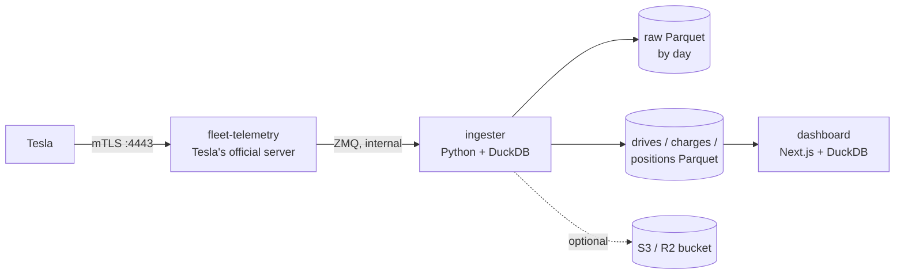

# Tesla Tracks

Self-hosted drive and charge logger for your Tesla, built on Tesla's official **Fleet Telemetry** streaming.
A lightweight, modern alternative to TeslaMate: no polling, no Postgres, no Grafana. The car pushes data to
your server only while it is awake, data lands in **Parquet** files, **DuckDB** turns them into drives and
charges, and a small **Next.js** dashboard shows them.

**[Live demo → tracks.victoriano.me](https://tracks.victoriano.me)** (made-up data for a fictional car; no login needed)



- **Never wakes the car.** The car streams only when it is awake anyway, and only values that changed.
- **Cheap.** Tesla bills Fleet API usage per signal, with a monthly credit for individuals that a single car
  normally stays within (estimate; check your own usage in the developer dashboard).
- **Plain files.** Raw telemetry is the source of truth; derived tables are recomputed from it, so improving
  the detection logic fixes your whole history. Query everything with DuckDB, Python, or anything that reads Parquet.
- **Optional S3/R2 mirror** of all Parquet files for backup or querying from elsewhere.

## Try it without a car

```bash
uv sync
TT_DATA_DIR=./data uv run tesla-tracks demo      # writes FAKE data for a demo car
cd web && npm install && TT_DATA_DIR=../data npm run dev
```

### Public demo

Want to show it without exposing your own drives? `deploy/refresh-demo.sh` fills `./demo-data` with made-up drives
and charges, and `docker compose --profile demo up -d web-demo` serves them on `127.0.0.1:3001` with a demo banner.
Run the script daily so the dates stay recent.

## What you need

- A Linux server with Docker and a public IP.
- A domain you control. One hostname (e.g. `tesla.example.com`) is registered with Tesla, serves the public key,
  and receives the car's stream on port 4443. It must **not** sit behind a proxy that terminates TLS
  (Cloudflare: DNS only / grey cloud), because the car authenticates with a client certificate.
- A Let's Encrypt certificate for that hostname (Caddy or certbot). `telemetry/ca.pem` holds the
  Let's Encrypt roots that the car uses to verify your server.
- A [Tesla developer](https://developer.tesla.com) account with a payment method (required even when usage
  stays within the monthly credit).
- Car firmware 2024.26 or newer.

## Setup

1. **Clone and configure**
   ```bash
   git clone https://github.com/<you>/tesla-tracks && cd tesla-tracks
   cp .env.example .env            # fill in as you go
   uv sync
   ```
2. **Key pair** — `uv run tesla-tracks keygen` creates `secrets/private-key.pem` (back it up, never share it)
   and `public/.well-known/appspecific/com.tesla.3p.public-key.pem`.
3. **Serve the public key and get a certificate** on `TESLA_APP_DOMAIN`:
   - no web server yet: `docker compose --profile caddy up -d caddy` (uses `deploy/Caddyfile`), or
   - existing Caddy/nginx: serve `public/.well-known/` on that hostname (see `deploy/Caddyfile`). With Caddy,
     force Let's Encrypt (`tls { issuer acme }`) so the certificate chains to `telemetry/ca.pem`.
4. **Create the Tesla app** at developer.tesla.com: allowed origin `https://TESLA_APP_DOMAIN`, redirect URI
   `TESLA_REDIRECT_URI`, scopes: vehicle information, vehicle location, vehicle commands, charging.
   Put the client id/secret in `.env`, then register your domain in your region:
   ```bash
   uv run tesla-tracks register
   ```
5. **Log in as the car owner** — `uv run tesla-tracks login` prints a URL; approve, then paste back the URL
   you were redirected to. Tokens are stored in `secrets/tokens.json` (mode 600) and refreshed automatically.
6. **Install the virtual key on the car** — `uv run tesla-tracks pair-url`, open the link on your phone near
   the car and approve with the key card.
7. **Start the stack**
   ```bash
   deploy/sync-certs.sh <cert.pem> <key.pem>   # copies the TLS cert for fleet-telemetry (run daily)
   docker compose up -d --build fleet-telemetry ingester web
   ```
   Open port 4443/tcp in your firewall.
8. **Point the car at your server**
   ```bash
   uv run tesla-tracks vehicles                       # find your VIN
   uv run tesla-tracks telemetry-config --vin <VIN>   # signs telemetry/fields.json with your key and sends it
   uv run tesla-tracks telemetry-status <VIN>         # wait for "synced": true; shows streaming errors
   ```
   The `ca` sent to the car contains the roots in `telemetry/ca.pem` plus the intermediates of your current
   certificate (`certs/fullchain.pem`), which is what Tesla's `check_server_cert.sh` validates against.
   Signing uses Tesla's `tesla-jws` (from the official `tesla/vehicle-command` image, or a local binary on PATH).
   The configuration expires (default 360 days): re-run `telemetry-config` before then.

The dashboard listens on `127.0.0.1:3000`. Put it behind your reverse proxy **with authentication**
(basic auth, Cloudflare Access, Tailscale...): it shows where you have been.

### Certificate renewals

`fleet-telemetry` reads its certificate only at start-up. Run `deploy/sync-certs.sh` daily (cron or a systemd
timer); it restarts the container only when the certificate changed.

### S3 / Cloudflare R2 mirror

Set `S3_BUCKET`, `S3_ENDPOINT_URL`, `AWS_ACCESS_KEY_ID`, `AWS_SECRET_ACCESS_KEY` in `.env`. The ingester
uploads new and changed Parquet files and removes ones deleted by compaction. Query the bucket with DuckDB:

```sql
INSTALL httpfs; LOAD httpfs;
CREATE SECRET (TYPE r2, KEY_ID '...', SECRET '...', ACCOUNT_ID '...');
SELECT * FROM 'r2://<bucket>/tesla-tracks/derived/drives.parquet' ORDER BY start_ts DESC;
```

## Data

| Path | Contents |
|---|---|
| `data/raw/telemetry/date=YYYY-MM-DD/*.parquet` | Every signal: `ts, received_at, vin, field, value_num, value_str, is_resend` (long format, schema never changes) |
| `data/raw/connectivity/…` | Car connect/disconnect events |
| `data/raw/events/…` | Alerts and errors reported by the car |
| `data/derived/drives.parquet` | One row per drive: times, distance, battery, energy, Wh/km, speeds, temperature |
| `data/derived/charges.parquet` | One row per charging session: AC/DC, energy added, max power, battery, location |
| `data/derived/positions.parquet` | GPS track points of each drive with speed, power and battery |

**Drive detection:** a drive starts when the car is in D/R/N or moving, and ends when it has been stopped
(not in gear and not moving) for 3 minutes, or when the stream goes silent for 10 minutes. Short stops stay in
the same drive. **Charges:** from `DetailedChargeState` Starting/Charging until Complete/Stopped/Disconnected.

**Trip cost** = energy taken from the battery × a price per kWh that you pick in the dashboard (presets for home,
off-peak, Supercharger and other fast chargers, or any value; remembered in the browser). Set the currency with `TT_CURRENCY`.

Fleet Telemetry reports distances in miles and speeds in mph; Tesla Tracks stores km and km/h.

Which signals the car sends, and how often, is set in [`telemetry/fields.json`](telemetry/fields.json).

## Commands

```
tesla-tracks keygen | register | login | vehicles | pair-url
tesla-tracks telemetry-config --vin VIN | telemetry-status VIN | telemetry-delete VIN
tesla-tracks run        # the ingester (what the container runs)
tesla-tracks process    # recompute drives/charges/positions from raw data
tesla-tracks compact    # merge small raw files
tesla-tracks sync       # push Parquet to the S3/R2 bucket now
tesla-tracks demo       # fake data to try the dashboard
```

## Development

```bash
uv run pytest
uv run ruff check
cd web && npm run lint && npm run build
```

## Security notes

- `secrets/private-key.pem` can command your car if paired with vehicle-command scopes: keep it off git, back it up offline.
- `.env`, `secrets/`, `certs/` and `data/` are git-ignored.
- Expose only port 4443 (telemetry) and your authenticated dashboard.

## License

MIT
